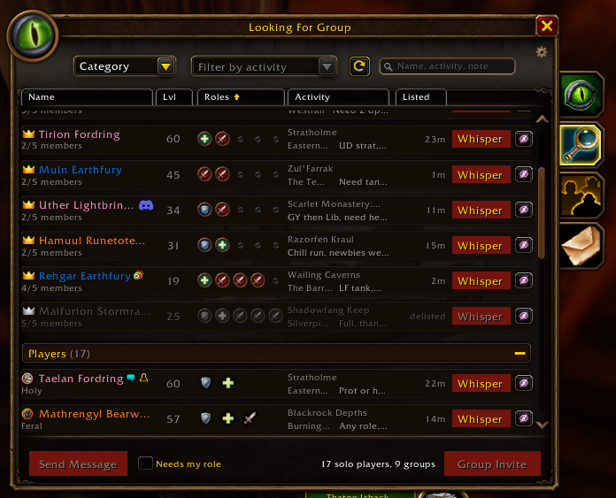
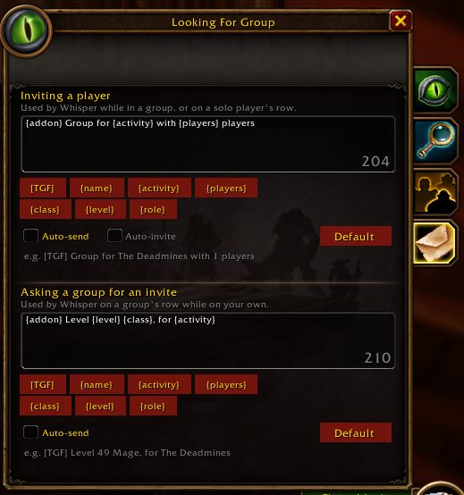

# TerribleGroupFinder

A group finder addon for **WoW Forever**. It improves the game's own group finder
in place, keeping its look: the Browse tab becomes a sortable table of solo players and
groups, and a new Messages tab holds whisper presets for contacting them in one click.

## Features

- **Results table** - the Browse tab lists solo players and groups in the game's two
  collapsible sections (groups first while you're on your own, solo players first while
  you lead), with class-coloured names, level, roles (a group's open slots), activity,
  zone and how long they've been listed
- **Sorting** - click a column header to sort each section by roles, level, activity or
  listed time
- **Player location** - each row shows where the solo player or the group's leader is,
  and a group's tooltip shows each member's zone
- **Nothing vanishes** - hidden players (until they list again), delisted listings and,
  with **Needs my role**, listings with no slot for you are greyed and moved to the end
  of their section
- **Search box** for a name, an activity or a note
- **Whisper presets** - a Whisper button on every row sends a preset message:
  - **Inviting a player**: used while you're in a group, or to a solo player
  - **Asking a group for an invite**: used on a group's row while you're on your own
- **Auto-send and Auto-invite** - send the message at once instead of opening the
  whisper box, and invite the solo player right after; the contact buttons then rest for
  a second, so no one gets messaged twice
- **Friend marks** - Battle.net friends, friends, guildmates and recent allies are marked
  on names, as the game marks them
- **Stock behaviour kept** - your own listing first with its delist button, Send Message
  and Group Invite at the bottom, right-click a row for the game's own menu, and the
  game's row tooltip

## Usage

- Open the group finder as usual; the Browse tab shows the table after a search
- **Messages** is the fourth tab on the side of the group finder. Edit the two presets
  there; the buttons under each box add a key, and **Default** restores the standard text
- Keys a preset can hold:

  | Key | Becomes |
  | --- | --- |
  | `[TGF]` | the addon's tag, always first |
  | `{name}` | the player you whisper |
  | `{activity}` | the first activity of their listing |
  | `{players}` | your current group size, counting you |
  | `{class}` / `{level}` | your class and level |
  | `{role}` | the roles you can play |

- `/tgf` toggles the table on Browse; `/tgf preview` switches between your search results
  and sample listings; `/tgf reset` restores the sample data; `/tgf version`

## Supported clients

- WoW Forever (interface 16001). Retail is not a target for now.

## Development

- Deploy to the local Forever client: `./scripts/install.bat` (set
  `TGF_WOW_ROOT` if WoW is not under `Program Files (x86)\World of Warcraft`).
- Local test zip: `./scripts/package.bat` writes `dist/TerribleGroupFinder-<version>-dev.zip`.
- Where the game has no group finder, `/tgf` opens a preview stand-in with the same
  layout, on sample data.
- Format with `stylua .` from the repo root.
- Release: `./scripts/release.bat <version>` from `main` tags and pushes;
  GitHub Actions packages it with the BigWigs packager.

Blizzard UI reference: [wow-ui-source](https://github.com/Gethe/wow-ui-source),
branch `forever` — mainly `Interface/AddOns/Blizzard_GroupFinder_VanillaStyle`
and `Blizzard_APIDocumentationGenerated/LFGList*Documentation.lua`.

## AI Usage

This addon was built with the help of [Claude AI](https://claude.ai/).
I'm an experienced Software Developer, but AI allows me to develop
stuff for myself and the community while I game :). Claude assisted
with writing the implementation, but all logic and testing is manually
done by me. The addon is maintained by me to the best of my abilities,
use at your own leisure.

The custom icons/art are not done by AI, I enjoy making barely
acceptable pixel art :)

## License

[GPL-3.0](LICENSE).
